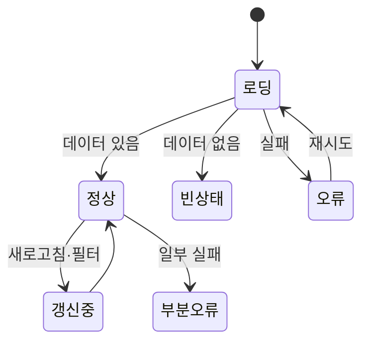

# 피드백과 상태

화면은 데이터가 있는 "정상" 상태 외에도 **로딩, 비어 있음, 오류, 부분 로드, 권한 없음** 같은 상태를 가집니다. 디자인 시안에는 보통 정상 상태만 있으므로 개발자가 나머지를 채워야 하고, 그 품질이 제품의 인상을 좌우합니다.

## 화면의 상태 목록

| 상태 | 반드시 답할 것 |
| --- | --- |
| 로딩 | 무엇을 기다리는가, 얼마나 걸리는가 |
| 빈 상태 | 왜 비었는가, 무엇을 하면 되는가 |
| 오류 | 무엇이 잘못됐는가, 어떻게 해결하는가 |
| 부분 | 무엇은 되고 무엇은 안 됐는가 |
| 권한 없음 | 왜 못 보는가, 누구에게 요청하는가 |
| 오프라인 | 지금 할 수 있는 것과 없는 것 |
| 성공 | 무엇이 됐는가, 다음은 무엇인가 |

## 로딩

| 방법 | 적합 | 주의 |
| --- | --- | --- |
| 스켈레톤 | 레이아웃이 예측 가능한 콘텐츠(목록, 카드) | 실제 레이아웃과 비슷하게 |
| 스피너 | 작은 영역, 버튼, 짧은 대기 | 전체 화면 스피너는 최후 수단 |
| 진행률 바 | 단계·비율을 아는 긴 작업(업로드) | 멈춘 것처럼 보이지 않게 |
| 낙관적 업데이트 | 성공 확률 높은 즉시 반영(좋아요, 체크) | 실패 시 되돌리고 알림 |
| 점진적 로드 | 핵심 먼저, 나머지 뒤에 | 레이아웃 이동 방지 |

| 규칙 | 설명 |
| --- | --- |
| 표시 지연 | 0.3초 이내에 끝나면 로딩 표시를 보이지 않게(깜빡임 방지) |
| 최소 표시 | 보였다면 0.5초 이상 유지 |
| 이전 콘텐츠 유지 | 필터 변경 시 빈 화면 대신 흐리게 + 로딩 |
| 취소 | 10초 이상이면 취소 제공 |
| 레이아웃 고정 | 로딩 전후 크기 변화 최소화 |

## 빈 상태

| 유형 | 메시지 | 행동 |
| --- | --- | --- |
| 첫 사용 | 무엇을 할 수 있는지 설명 | 첫 항목 만들기 버튼, 예시·템플릿 |
| 검색·필터 결과 없음 | "'xxx'에 대한 결과 없음" | 필터 초기화, 철자 제안 |
| 사용자가 비움 | "모두 완료했습니다" | 긍정적 확인 |
| 권한·설정으로 비어 있음 | 이유 | 설정 이동, 요청 |
| 오류로 비어 있음 | 오류 상태로 처리 | 재시도 |

빈 상태는 기능을 가르칠 기회입니다. 그림 하나와 "데이터가 없습니다"로 끝내지 않습니다.

## 오류

| 범위 | 표현 | 예 |
| --- | --- | --- |
| 필드 | 인라인 메시지 | [폼 설계](./forms.md) |
| 동작 | 토스트 또는 인라인 알림 | "저장하지 못했습니다. 다시 시도" |
| 영역 | 해당 영역만 오류 + 재시도 | 위젯 하나 실패, 나머지 정상 |
| 페이지 | 전체 오류 화면 | 404, 500, 권한 없음 |
| 연결 | 상단 배너 | 오프라인, 재연결 중 |

| 원칙 | 설명 |
| --- | --- |
| 원인 + 해결 | "네트워크 연결을 확인하고 다시 시도해 주세요" |
| 사용자 잘못 아님 | 시스템 오류는 사과, 사용자 오류는 안내 |
| 입력 보존 | 오류로 입력을 잃게 하지 않음 |
| 재시도 제공 | 버튼, 자동 재시도 표시 |
| 지원 경로 | 반복 실패 시 문의·오류 ID |
| 기술 정보 분리 | 오류 코드는 접힌 상세나 ID로 |

## 성공과 확인

| 상황 | 표현 |
| --- | --- |
| 가벼운 동작(저장, 설정 변경) | 토스트 "저장됨", 인라인 체크 |
| 중요한 완료(주문, 신청) | 완료 화면: 요약, 번호, 다음 단계 |
| 되돌릴 수 있는 삭제 | 즉시 실행 + "실행 취소" 토스트(5~10초) |
| 되돌릴 수 없는 동작 | 확인 대화상자 |

### 확인 대화상자

| 규칙 | 설명 |
| --- | --- |
| 꼭 필요할 때만 | 모든 동작에 확인을 넣으면 읽지 않고 누름 |
| 구체적 제목 | "삭제하시겠습니까?" 대신 "'프로젝트 A'를 삭제하시겠습니까?" |
| 결과 설명 | "복구할 수 없습니다. 3명의 멤버가 접근을 잃습니다" |
| 버튼 문구 | "확인/취소" 대신 "삭제/취소" |
| 위험 강조 | 파괴적 버튼은 위험 스타일, 기본 포커스는 취소 |
| 고위험 | 이름 입력 확인(저장소 삭제 등) |

## 알림 선택

| 채널 | 지속 | 적합 |
| --- | --- | --- |
| 토스트 | 수 초 자동 | 가벼운 성공·정보 |
| 인라인 알림(배너) | 닫을 때까지 | 영역 관련 경고·오류 |
| 모달 | 응답까지 | 결정 필요 |
| 상태 표시(배지, 점) | 상시 | 미읽음, 진행 중 |
| 시스템 알림·이메일 | 외부 | 사용자가 떠난 뒤 완료 |

관련: [사용성 원칙](../foundations/principles.md), [UX 라이팅](./microcopy.md), [예외 처리 전략](../../Backend/exception/exception-handling-strategy.md)

다음: [UX 라이팅](./microcopy.md)
