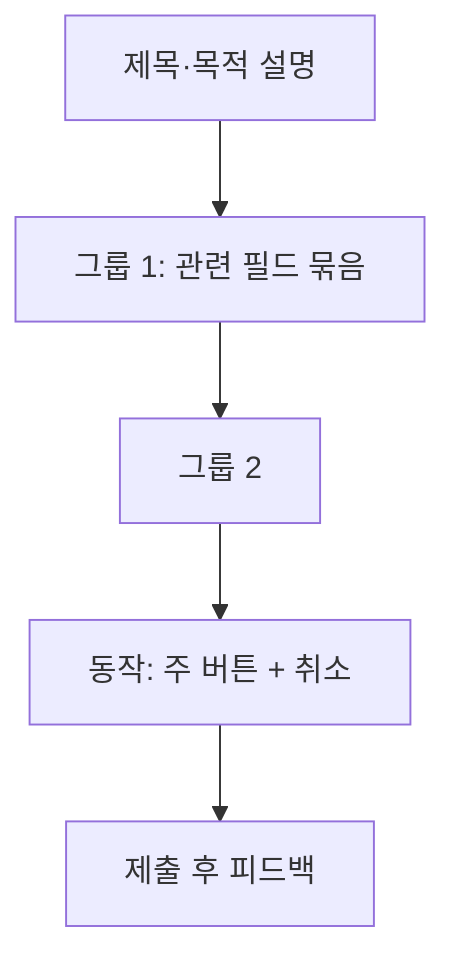

# 폼 설계

폼은 사용자가 가장 많이 실패하고 이탈하는 곳입니다. **필드를 줄이고, 무엇을 입력할지 미리 알려주고, 오류를 빨리 정확하게 알려주는** 것이 폼 설계의 전부에 가깝습니다.

## 필드 줄이기

| 질문 | 조치 |
| --- | --- |
| 이 값이 지금 꼭 필요한가 | 나중에 받거나 삭제 |
| 다른 값에서 유추할 수 있는가 | 우편번호→주소, 카드 번호→카드사 |
| 기본값이 있는가 | 가장 흔한 값, 이전 입력, 현재 위치 |
| 선택 항목인가 | "선택"으로 표시하고 뒤로 |
| 두 필드를 하나로 합칠 수 있는가 | 이름 성·이름 분리 → 한 필드(지역에 따라) |

필드 하나가 줄 때마다 완료율이 오릅니다. 마케팅·분석용 필드는 폼에서 뺍니다.

## 구성

| 원칙 | 설명 |
| --- | --- |
| 한 열 | 여러 열은 시선이 흔들림. 짧은 관련 필드(우편번호·상세)만 나란히 |
| 논리적 순서 | 사용자가 생각하는 순서(이름→연락처→주소) |
| 그룹과 제목 | 5개 이상이면 그룹으로 나누고 제목 |
| 라벨 위치 | 위쪽(빠름, 모바일 친화). 왼쪽은 긴 폼·넓은 화면 |
| 필수·선택 표시 | 대부분 필수면 선택만 "(선택)", 반대면 필수만 `*` + 설명 |
| 도움말 | 라벨 아래 또는 입력 아래, 입력 전에 보임 |
| 동작 버튼 | 폼 끝, 주 버튼 하나, 파괴적 동작은 멀리 |

## 입력 보조

| 보조 | 예 |
| --- | --- |
| 입력 형식 안내 | "YYYY-MM-DD", 예시 값 |
| 자동 포맷 | 전화번호 하이픈, 카드 번호 4자리 묶음, 금액 쉼표 |
| 자동 완성 | `autocomplete` 속성(이름, 이메일, 주소) |
| 적절한 키보드 | `type=email`, `inputmode=numeric` |
| 자동 채움 | 우편번호 검색, 사업자번호 조회 |
| 붙여넣기 허용 | 비밀번호·인증번호 붙여넣기 막지 않음 |
| 비밀번호 보기 | 토글 제공 |

## 검증 시점

| 시점 | 적합 | 주의 |
| --- | --- | --- |
| 입력 중(실시간) | 형식 피드백(비밀번호 강도, 글자 수) | 타이핑 중 오류 표시는 짜증. 조건 충족 표시는 좋음 |
| 포커스 벗어날 때(blur) | 형식·필수 검증 | 가장 균형적. 단, 빈 필드를 떠날 때 즉시 오류는 피함 |
| 제출 시 | 서버 검증, 교차 필드 검증 | 첫 오류 필드로 포커스 이동, 오류 요약 |
| 재검증 | 오류 상태 필드는 수정 즉시 재검증 | 고쳤는데 오류가 남아 있으면 혼란 |

| 규칙 | 설명 |
| --- | --- |
| 클라이언트 + 서버 | 클라이언트는 편의, 서버는 보안·진실 |
| 제출 버튼 비활성 금지 | 왜 못 누르는지 모름. 누르게 하고 오류 표시 |
| 오류 유지 | 제출 실패 시 입력값 보존 |

## 오류 메시지

| 원칙 | 나쁜 예 | 좋은 예 |
| --- | --- | --- |
| 무엇이 잘못됐는지 | "잘못된 입력" | "이메일 형식이 아닙니다" |
| 어떻게 고치는지 | "유효하지 않음" | "비밀번호는 8자 이상, 숫자 포함" |
| 필드 옆에 | 화면 상단에만 | 필드 아래 + 상단 요약(긴 폼) |
| 색 + 아이콘 + 텍스트 | 빨간 테두리만 | 세 가지 모두 |
| 비난하지 않음 | "잘못 입력하셨습니다" | "확인해 주세요" |
| 기술 용어 금지 | "422 Unprocessable Entity" | "저장하지 못했습니다. 다시 시도해 주세요" |

문구 규칙은 [UX 라이팅](./microcopy.md)을 참고합니다.

## 긴 폼

| 방법 | 적합 |
| --- | --- |
| 단계 분리(마법사) | 10개 이상 필드, 논리적 단계 구분, 진행 표시와 뒤로 가기 |
| 섹션 접기 | 선택 항목이 많을 때 |
| 임시 저장 | 수 분 이상 걸리는 폼. 자동 저장 + "저장됨" 표시 |
| 요약 확인 | 제출 전 입력 내용 확인 화면(결제, 신청) |
| 진행률 | 단계 수·현재 단계, 남은 시간 추정 |

## 제출 후

| 상황 | 처리 |
| --- | --- |
| 처리 중 | 버튼 로딩, 중복 제출 방지 |
| 성공 | 명확한 완료 메시지, 다음 행동, 입력 내용 요약 |
| 실패(서버) | 입력 보존, 원인·재시도, 지원 연락 |
| 부분 성공 | 무엇이 됐고 안 됐는지 |
| 이탈 | 수정 중 떠나면 확인(저장 안 됨 경고) |

## 접근성 점검

| 항목 | 확인 |
| --- | --- |
| 라벨 연결 | `label for` 또는 `aria-labelledby` |
| 오류 연결 | `aria-describedby`, `aria-invalid`, 제출 시 오류 요약에 포커스 |
| 그룹 | `fieldset`·`legend`(라디오·체크박스 그룹) |
| 키보드 | Tab 순서가 시각 순서와 일치 |
| 필수 | `required` 또는 `aria-required` + 시각 표시 |

관련: [컴포넌트 규칙](./components.md), [웹 접근성](../../Web/accessibility.md), [API 설계](../../API/api-design.md)의 오류 응답

다음: [피드백과 상태](./feedback-and-states.md)
