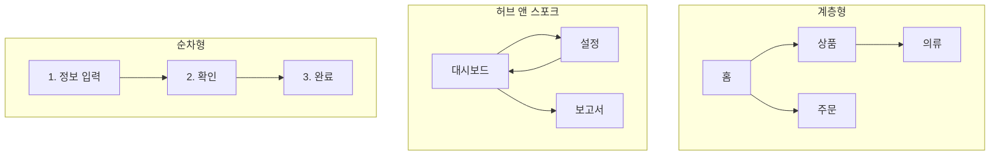

# 정보 구조(Information Architecture)

정보 구조는 **콘텐츠와 기능을 어떻게 분류하고 이름 붙이고 연결할지**를 정하는 일입니다. 화면 디자인보다 먼저 결정되어야 하며, 잘못되면 아무리 예쁜 화면도 "어디 있는지 모르겠다"는 문제를 낳습니다.

## 구성 요소

| 요소 | 질문 | 산출물 |
| --- | --- | --- |
| 분류 체계 | 무엇을 어떤 기준으로 묶는가 | 콘텐츠 분류표 |
| 라벨링 | 각 묶음과 항목을 무엇이라 부르는가 | 용어 목록 |
| 내비게이션 | 어떻게 이동하는가 | 메뉴 구조, 사이트맵 |
| 검색 | 어떻게 찾는가 | 검색 범위, 결과 구성 |

## 분류 기준

| 기준 | 예 | 적합 |
| --- | --- | --- |
| 주제 | 상품 카테고리, 문서 분야 | 탐색형 콘텐츠 |
| 과업 | "주문하기", "환불 신청" | 할 일이 분명한 서비스 |
| 사용자 유형 | 개인·기업, 학생·교직원 | 역할별로 내용이 크게 다를 때 |
| 시간 | 최신순, 일정 | 뉴스, 활동 기록 |
| 알파벳·가나다 | 용어집, 색인 | 이름을 아는 경우 |

사용자의 머릿속 분류와 조직의 분류는 다릅니다. 조직도대로 메뉴를 만들면 사용자는 길을 잃습니다. 카드 소팅으로 사용자의 분류를 확인합니다.

## 구조 유형

| 유형 | 특징 | 적합 |
| --- | --- | --- |
| 계층형 | 넓고 얕게 또는 좁고 깊게 | 대부분의 사이트·앱 |
| 허브 앤 스포크 | 중심에서 각 기능으로, 다시 중심으로 | 모바일 앱, 대시보드 |
| 순차형 | 정해진 순서 | 가입, 결제, 마법사 |
| 매트릭스 | 여러 축으로 탐색(필터) | 상품 목록, 검색 결과 |
| 데이터베이스형 | 메타데이터 기반 동적 구성 | 콘텐츠가 많고 다면적 |

깊이는 3단계 이내, 한 수준의 항목은 7개 안팎이 일반적인 기준입니다. 항목이 많으면 깊게 파기보다 검색·필터를 보강합니다.

## 내비게이션 패턴

| 패턴 | 설명 | 적합 |
| --- | --- | --- |
| 전역 내비게이션 | 모든 화면에 있는 주 메뉴 | 최상위 5~7개 |
| 지역 내비게이션 | 현재 섹션 안의 하위 메뉴 | 사이드바, 탭 |
| 브레드크럼 | 현재 위치의 경로 | 깊은 계층 |
| 하단 탭(모바일) | 3~5개 주요 영역 | 앱 |
| 햄버거 메뉴 | 숨긴 메뉴 | 보조 항목만. 주요 기능을 숨기면 사용률 급감 |
| 문맥 링크 | 본문 안의 관련 링크 | 콘텐츠 사이트 |
| 유틸리티 | 검색, 계정, 알림 | 우상단 관례 |

| 상태 표시 | 내용 |
| --- | --- |
| 현재 위치 | 활성 메뉴 강조, 브레드크럼, 페이지 제목 |
| 갈 수 있는 곳 | 메뉴가 보이거나 쉽게 열림 |
| 왔던 곳 | 뒤로 가기가 예상대로 동작, 방문 링크 구분 |

## 라벨링

| 원칙 | 나쁜 예 | 좋은 예 |
| --- | --- | --- |
| 사용자 언어 | "자산 관리" | "내 기기" |
| 구체적 | "기타", "도구" | "내보내기", "알림 설정" |
| 일관 | 메뉴는 "주문", 페이지 제목은 "구매 내역" | 둘 다 "주문 내역" |
| 짧게 | "고객님의 등록된 배송지 목록" | "배송지" |
| 동사형(동작)·명사형(장소) 구분 | 동작 버튼에 "설정" | "저장", 메뉴에 "설정" |

검색 로그와 지원 문의의 단어가 가장 좋은 라벨 후보입니다.

## 검색

| 결정 | 권장 |
| --- | --- |
| 범위 | 전체 vs 현재 섹션을 명시 |
| 입력 보조 | 자동 완성, 최근 검색, 오타 보정 |
| 결과 | 유형별 구분, 핵심 정보 미리보기, 필터 |
| 결과 없음 | 대안 제시(철자, 상위 카테고리, 인기 항목) |
| 분석 | 검색어·결과 없음 비율을 IA 개선에 활용 |

## 사이트맵과 검증

| 활동 | 내용 |
| --- | --- |
| 사이트맵 작성 | 모든 화면·섹션을 트리로. 화면 ID 부여 |
| 카드 소팅(열린·닫힌) | 사용자가 항목을 분류·이름 붙임 / 주어진 분류에 넣음 |
| 트리 테스트 | 메뉴 트리만 주고 "X를 어디서 찾겠는가" 과제. 화면 없이 IA만 검증 |
| 첫 클릭 테스트 | 첫 클릭이 맞으면 대부분 성공 |

관련: [사용자 조사](./research.md), [사용성 원칙](./principles.md), 이 저장소 뷰어의 트리·검색 구조

다음: [레이아웃과 간격](../visual/layout-and-spacing.md)
