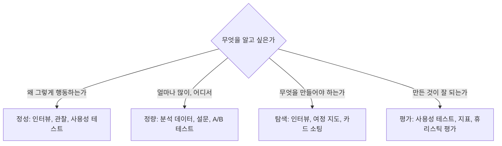

# 사용자 조사

사용자 조사는 **추측을 관찰로 바꾸는 활동**입니다. 큰 예산이 없어도 사용자 다섯 명과의 대화나 분석 데이터 하나로 대부분의 결정을 뒷받침할 수 있습니다. 개발자가 직접 할 수 있는 방법 위주로 정리합니다.

## 방법 선택

| 방법 | 답하는 질문 | 비용 | 참가자 수 |
| --- | --- | --- | --- |
| 사용자 인터뷰 | 목표, 맥락, 불편 | 낮음 | 5~8명 |
| 현장 관찰 | 실제 환경에서 어떻게 쓰는가 | 중간 | 3~5명 |
| 사용성 테스트 | 과제를 완료할 수 있는가, 어디서 막히는가 | 낮음~중간 | 5명/회 |
| 설문 | 비율, 선호, 만족도 | 낮음 | 수십~수백 |
| 분석 데이터 | 어디서 이탈·실패하는가 | 낮음(도구 있으면) | 전체 |
| A/B 테스트 | 어느 안이 지표를 높이는가 | 중간 | 통계적 유의 수준까지 |
| 휴리스틱 평가 | 원칙 위반은 어디인가 | 낮음 | 전문가 2~3명 |
| 카드 소팅 | 사용자가 정보를 어떻게 분류하는가 | 낮음 | 15명 이상 |

## 인터뷰

| 원칙 | 설명 |
| --- | --- |
| 과거 행동을 물음 | "쓰시겠어요?"(예측) 대신 "지난번엔 어떻게 하셨어요?"(사실) |
| 열린 질문 | "어땠어요?"보다 "그때 무슨 일이 있었는지 말씀해 주세요" |
| 유도하지 않음 | "이 기능이 편하죠?" 금지 |
| 침묵 허용 | 답을 대신 채우지 않음 |
| 5 Whys | 불편의 원인을 따라 내려감 |
| 기록 | 녹음(동의 후), 한 사람은 질문·한 사람은 기록 |

| 질문 예 |
| --- |
| 이 일을 마지막으로 하셨던 때를 떠올려 주세요. 처음부터 어떻게 진행됐나요? |
| 그 과정에서 가장 번거로웠던 건 무엇이었나요? |
| 지금은 그 문제를 어떻게 해결하고 계세요? |
| 그 도구를 쓰다가 그만둔 적이 있다면 왜였나요? |

## 사용성 테스트

| 단계 | 내용 |
| --- | --- |
| 준비 | 과제 3~5개("배송지를 추가하세요"), 성공 기준, 프로토타입 또는 실제 화면 |
| 모집 | 실제 사용자와 가까운 5명. 5명이면 주요 문제의 대부분 발견 |
| 진행 | 생각을 소리 내어 말하게 함(think-aloud), 도와주지 않음, 30~45분 |
| 기록 | 과제별 성공·실패·시간, 막힌 지점, 발언 |
| 분석 | 문제를 심각도(차단·심각·경미)로 분류, 빈도 집계 |
| 공유 | 짧은 영상 클립이 보고서보다 설득력 큼 |

원격 비대면 테스트도 화면 공유만으로 충분합니다. 완성 전 프로토타입(클릭 가능한 시안)으로 테스트하면 수정 비용이 가장 낮습니다.

## 페르소나와 여정 지도

| 도구 | 내용 | 주의 |
| --- | --- | --- |
| 페르소나 | 대표 사용자 유형: 목표, 맥락, 숙련도, 불편 | 조사 데이터 기반. 상상으로 만들면 해로움 |
| 과업 분석 | 사용자가 목표를 이루는 단계와 결정 | 현재 방식 그대로 기록 |
| 여정 지도 | 단계별 행동·생각·감정·접점·불편 | 불편이 집중된 단계가 개선 기회 |
| JTBD | "사용자는 ~하려고 이 제품을 고용한다" | 기능이 아니라 목표에 집중 |

## 분석 데이터

| 지표 | 보는 것 | 해석 주의 |
| --- | --- | --- |
| 퍼널 전환율 | 단계별 이탈 | 이탈 이유는 정성 조사로 |
| 과제 성공률 | 핵심 작업 완료 비율 | 성공 정의를 먼저 |
| 소요 시간 | 작업에 걸린 시간 | 긴 시간이 몰입일 수도 |
| 오류율 | 검증 실패, 재시도 | 어느 필드인지 세분화 |
| 기능 사용률 | 무엇이 쓰이고 안 쓰이는가 | 안 쓰임 = 못 찾음일 수 있음 |
| 검색어 | 사용자가 찾는 것과 쓰는 단어 | 라벨링·IA 개선 자료 |
| 지원 문의 | 반복되는 질문 | 가장 싼 조사 자료 |

## 조사 결과를 결정으로

| 산출물 | 형태 |
| --- | --- |
| 발견 사항 | "5명 중 4명이 필터를 찾지 못함" 같은 관찰 + 근거 |
| 문제 목록 | 심각도·빈도로 정렬 |
| 설계 변경 | 각 문제에 대한 대응과 검증 방법 |
| 가설 | "필터를 목록 위로 옮기면 사용률이 오를 것" → 지표로 확인 |

관련: [협업과 측정](../process/workflow.md), [정보 구조](./information-architecture.md)

다음: [정보 구조](./information-architecture.md)
