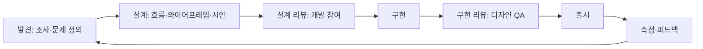

# 협업과 측정

좋은 UX는 디자이너 혼자 만들지 않습니다. 개발자가 설계 초기에 참여하고, 디자이너가 구현 결과를 함께 검토하며, 출시 후 지표로 확인하는 **순환**이 필요합니다. 이 문서는 디자인-개발 협업 흐름, 핸드오프, 리뷰, 측정을 다룹니다.

## 흐름

| 단계 | 개발자의 역할 |
| --- | --- |
| 발견 | 기술 제약·기존 데이터 공유, 지원 문의·로그 제공 |
| 설계 | 실현 가능성, 상태·예외 지적("빈 목록이면?", "실패하면?"), 기존 컴포넌트 제안 |
| 설계 리뷰 | 누락 상태·접근성·성능 관점 검토 |
| 구현 | 시안과 디자인 시스템을 따르되 차이가 생기면 즉시 공유 |
| 구현 리뷰 | 디자이너가 실제 화면 검토, 차이 목록 정리 |
| 측정 | 지표·이벤트 심기, 결과 공유 |

개발자가 설계 단계에 늦게 들어오면 구현 불가·상태 누락이 뒤늦게 발견됩니다. 와이어프레임 단계부터 참여합니다.

## 산출물과 충실도

| 산출물 | 충실도 | 목적 | 검토 질문 |
| --- | --- | --- | --- |
| 사용자 흐름도 | 낮음 | 화면 사이의 이동과 분기 | 모든 경로가 끝나는가, 막다른 곳은 |
| 와이어프레임 | 낮음 | 구조·배치·우선순위 | 핵심 동작이 보이는가 |
| 프로토타입 | 중간 | 사용성 테스트, 상호작용 확인 | 실제처럼 눌러 볼 수 있는가 |
| 시안(하이파이) | 높음 | 최종 외관, 핸드오프 | 모든 상태가 있는가 |
| 명세 | - | 동작·규칙·예외 | 구현에 필요한 정보가 다 있는가 |

낮은 충실도에서 구조 문제를 잡고, 높은 충실도에서는 세부만 논의합니다. 와이어프레임에 색 이야기를 하면 시간이 낭비됩니다.

## 핸드오프 점검표

| 항목 | 확인 |
| --- | --- |
| 상태 | 로딩, 빈 상태, 오류, 비활성, 호버·포커스, 긴 텍스트, 많은 항목 |
| 반응형 | 주요 브레이크포인트별 레이아웃 |
| 토큰 | 색·간격·글꼴이 디자인 시스템 토큰으로 지정 |
| 컴포넌트 | 기존 컴포넌트 사용 여부, 새 컴포넌트면 사유 |
| 상호작용 | 클릭·호버·전환·애니메이션 동작, 지속 시간 |
| 문구 | 최종 문구(임시 텍스트 아님), 번역 필요 여부 |
| 접근성 | 대비, 포커스 순서, 대체 텍스트, 라벨 |
| 데이터 | 실제 데이터 형태(길이, 극단값)로 검토 |
| 에셋 | 아이콘·이미지 형식과 크기 |
| 예외 | 권한 없음, 오프라인, 한도 초과 |

빠진 항목은 구현 중 개발자가 임의로 정하게 됩니다. 핸드오프 전에 함께 채웁니다.

## 디자인 QA

| 항목 | 방법 |
| --- | --- |
| 픽셀 비교 | 시안과 구현을 나란히, 간격·크기·색 차이 |
| 상태 확인 | 각 상태를 실제로 재현 |
| 실제 데이터 | 긴 이름, 0건, 1,000건, 특수문자 |
| 기기 | 실제 폰·태블릿, 주요 브라우저 |
| 접근성 | 키보드만, 스크린 리더, 확대 200% |
| 차이 목록 | 심각도(차단·수정·개선 제안)로 분류해 이슈로 |

"시안과 다르다"가 모두 버그는 아닙니다. 구현 중 더 나은 결정이 있었다면 시안을 갱신합니다.

## 디자인 리뷰 진행

| 원칙 | 설명 |
| --- | --- |
| 목표 먼저 | 이 화면이 해결하는 문제와 성공 기준 공유 |
| 질문으로 | "이 버튼은 왜 여기인가요?"가 "옮기세요"보다 생산적 |
| 원칙 근거 | 취향 대신 [사용성 원칙](../foundations/principles.md)·시스템 규칙 인용 |
| 범위 분리 | 구조 문제와 세부 문제를 섞지 않음 |
| 결정 기록 | 합의와 근거를 남김. 반복 논의 방지 |

## UX 지표

| 지표 | 측정 | 용도 |
| --- | --- | --- |
| 과제 성공률 | 핵심 작업 완료 비율 | 사용성의 기본 지표 |
| 과제 소요 시간 | 시작~완료 | 효율 |
| 오류율 | 검증 실패, 잘못된 경로, 되돌리기 | 혼란 지점 |
| 전환율·퍼널 | 단계별 이탈 | 흐름 병목 |
| 기능 채택률 | 노출 대비 사용 | 발견 가능성 |
| 유지율 | 재방문·재사용 | 장기 가치 |
| 만족도(SUS, CSAT, NPS) | 설문 | 추세 비교. 절대값보다 변화 |
| 지원 문의 수 | 주제별 | 가장 싼 문제 탐지기 |
| 접근성 위반 수 | 자동 검사 | 품질 게이트 |

| 운영 | 설명 |
| --- | --- |
| 이벤트 설계 | 화면 진입, 핵심 동작, 성공·실패를 구현 시 함께 심음 |
| 가설과 연결 | "변경 X로 지표 Y가 오를 것" → 출시 후 확인 |
| 정성과 함께 | 숫자는 "무엇"을, 관찰은 "왜"를 |
| 대시보드 | 핵심 지표 5개 이내, 팀이 매주 봄 |

## 디자이너가 없을 때

| 상황 | 대응 |
| --- | --- |
| 내부 도구·관리 화면 | 디자인 시스템 또는 완성 컴포넌트 라이브러리 그대로, 표준 패턴만 사용 |
| 새 화면 설계 | 유사한 제품의 관례 따르기, 와이어프레임을 텍스트·박스로 그려 동료 검토 |
| 문구 | [UX 라이팅](../components/microcopy.md) 점검표 |
| 검증 | 동료 2~3명에게 과제 주고 지켜보기 |
| AI 활용 | 시안 초안·대안 생성에 활용하되 원칙·시스템 규칙으로 검토 |

관련: [사용자 조사](../foundations/research.md), [코드 리뷰](../../Utility/collaboration/code-review.md), [디자인 시스템](../systems/design-system.md)
