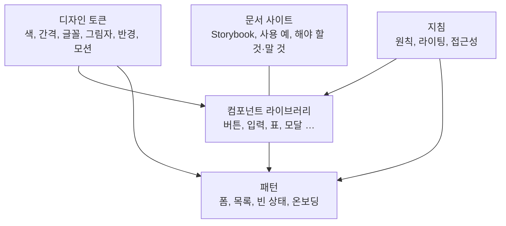

# 디자인 시스템

디자인 시스템은 **토큰, 컴포넌트, 패턴, 지침을 하나의 출처로 묶은 것**입니다. 화면마다 색과 간격을 다시 정하지 않게 하고, 디자이너와 개발자가 같은 이름으로 같은 것을 가리키게 합니다. 큰 조직의 전유물이 아니라 토큰 파일 하나와 컴포넌트 몇 개에서 시작할 수 있습니다.

## 구성



| 층 | 내용 | 산출물 |
| --- | --- | --- |
| 토큰 | 디자인 결정의 최소 단위 | JSON·CSS 변수·플랫폼별 코드 |
| 컴포넌트 | 토큰으로 만든 재사용 UI | 코드 라이브러리 + 디자인 도구 컴포넌트 |
| 패턴 | 컴포넌트 조합 규칙 | 문서, 템플릿 |
| 지침 | 원칙, 톤, 접근성 | 문서 |

## 디자인 토큰

| 범주 | 예 |
| --- | --- |
| 색 | `color-primary`, `color-bg-surface`, `color-text-secondary` |
| 간격 | `space-1`(4px) … `space-8`(64px) |
| 글꼴 | `font-size-body`, `font-weight-semibold`, `line-height-tight` |
| 반경 | `radius-sm`(4px), `radius-md`(8px), `radius-full` |
| 그림자·높이 | `elevation-1`, `elevation-2` |
| 모션 | `duration-fast`(150ms), `easing-standard` |
| 크기 | `size-control-md`(36px), `size-icon-sm`(16px) |
| z-index | `z-dropdown`, `z-modal`, `z-toast` |

| 원칙 | 설명 |
| --- | --- |
| 원시 → 의미 → 컴포넌트 | [색상](../visual/color.md)의 3층. 코드는 의미·컴포넌트 토큰만 |
| 단일 출처 | 토큰 파일(JSON 등)에서 CSS·iOS·Android 코드 생성(Style Dictionary 등) |
| 이름은 역할 | `blue-500` 대신 `color-primary`, `16px` 대신 `space-4` |
| 테마 | 라이트·다크·브랜드별로 의미 토큰 값만 교체 |

```json
{
  "color": { "primary": { "value": "{blue.600}" }, "text": { "value": "{gray.900}" } },
  "space": { "4": { "value": "16px" } }
}
```

## 컴포넌트 라이브러리

| 항목 | 기준 |
| --- | --- |
| 포함 기준 | 세 곳 이상에서 쓰이거나 쓰일 것이 확실한 것. 한 번 쓰는 것은 제품 코드에 |
| API | props는 의미 기반(`variant="danger"`), 스타일 덮어쓰기는 제한 |
| 상태 | [컴포넌트 규칙](../components/components.md)의 모든 상태 구현 |
| 접근성 | 키보드·스크린 리더 동작을 라이브러리가 보장 |
| 조합 | 작은 원자(버튼, 아이콘) → 분자(검색 입력) → 패턴(필터 바) |
| 문서 | 언제 쓰는가, 언제 쓰지 않는가, 예제, 접근성 노트 |

| 선택지 | 설명 |
| --- | --- |
| 직접 구축 | 완전한 통제, 비용 큼 |
| 헤드리스 라이브러리(Radix, Headless UI, React Aria 등) + 자체 스타일 | 동작·접근성은 가져오고 외관은 토큰으로. 균형적 |
| 완성 라이브러리(MUI, Ant Design 등) 테마 적용 | 빠름, 커스터마이징 한계 |

## 문서화

| 요소 | 내용 |
| --- | --- |
| 컴포넌트 카탈로그 | Storybook 등. 모든 변형·상태를 실제 코드로 |
| 사용 지침 | 해야 할 것·하지 말 것을 그림 쌍으로 |
| 토큰 표 | 이름, 값, 용도 |
| 패턴 | 폼, 목록, 대시보드 구성 예 |
| 변경 이력 | 버전, 파괴적 변경, 마이그레이션 |

## 운영

| 항목 | 권장 |
| --- | --- |
| 소유 | 담당자(또는 팀) 지정, 기여 절차 |
| 버전 | 시맨틱 버전, 파괴적 변경은 메이저 + 코드모드·마이그레이션 가이드 |
| 기여 | 제품 팀이 필요한 컴포넌트를 제안 → 검토 → 라이브러리로 승격 |
| 채택 측정 | 토큰·컴포넌트 사용률, 직접 스타일 비율 |
| 디자인-코드 동기화 | 디자인 도구의 변수·컴포넌트와 코드 토큰·컴포넌트의 이름 일치 |
| 품질 게이트 | 시각 회귀 테스트, 접근성 자동 검사, 린트(토큰 외 값 금지) |

## 시작하는 순서

| 단계 | 내용 |
| --- | --- |
| 1 | 현재 제품의 색·간격·글꼴을 모두 수집(인벤토리). 보통 수십 개의 비슷한 회색이 나옴 |
| 2 | 토큰으로 정리하고 CSS 변수로 배포 |
| 3 | 가장 많이 쓰는 컴포넌트 5개(버튼, 입력, 선택, 모달, 표)부터 라이브러리화 |
| 4 | 새 화면은 라이브러리만 사용, 기존 화면은 손댈 때 교체 |
| 5 | 문서 사이트와 기여 절차 |

관련: [색상](../visual/color.md), [레이아웃과 간격](../visual/layout-and-spacing.md), [컴포넌트 규칙](../components/components.md)

다음: [반응형과 모션](./responsive-and-motion.md)
