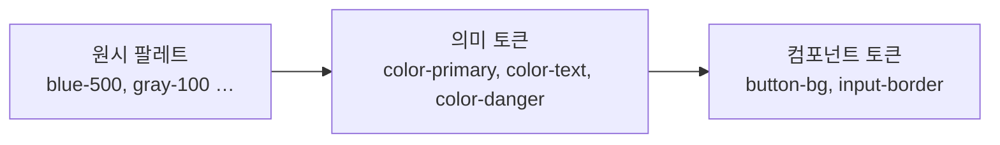

# 색상

색은 **의미를 전달하고, 위계를 만들고, 브랜드를 표현**합니다. 체계 없이 쓰면 화면마다 색이 늘어나고 의미가 흐려집니다. 역할 기반 팔레트를 정의하고, 대비 기준을 지키고, 색에만 의존하지 않는 것이 핵심입니다.

## 팔레트 구성



| 층 | 예 | 설명 |
| --- | --- | --- |
| 원시(primitive) | `blue-50`~`blue-900`, `gray-50`~`gray-900` | 실제 색값. 10단계 명도 램프 |
| 의미(semantic) | `color-primary`, `color-text-secondary`, `color-bg-surface` | 역할. 테마에 따라 원시 색이 바뀜 |
| 컴포넌트 | `button-primary-bg`, `input-border-focus` | 의미 토큰을 참조 |

코드에서는 의미·컴포넌트 토큰만 씁니다. `blue-500`을 직접 쓰면 다크 모드와 리브랜딩에서 전부 수정해야 합니다.

## 역할별 색

| 역할 | 수 | 용도 |
| --- | --- | --- |
| 주 색(primary) | 1 | 주요 동작, 활성 상태, 링크 |
| 보조 색(secondary) | 0~1 | 보조 강조. 없어도 됨 |
| 중립(neutral) | 회색 램프 | 텍스트, 배경, 테두리, 비활성. 화면의 90% |
| 의미색 | 4 | 성공(초록), 경고(노랑·주황), 오류(빨강), 정보(파랑) |
| 데이터 시각화 | 6~8 | 차트 계열색. 구분 가능하고 색각 이상 고려 |

| 원칙 | 설명 |
| --- | --- |
| 60-30-10 | 배경·중립 60%, 보조 30%, 강조 10% |
| 의미색은 의미에만 | 빨강을 장식으로 쓰면 오류 표시가 약해짐 |
| 주 색은 하나 | 강조가 여럿이면 위계가 사라짐 |
| 순흑·순백 피함 | 텍스트는 진한 회색, 배경은 살짝 따뜻하거나 차가운 흰색 |

## 대비

| 요소 | WCAG AA 최소 | 비고 |
| --- | --- | --- |
| 본문 텍스트 | 4.5:1 | |
| 큰 텍스트 | 3:1 | 18px 굵게 또는 24px 이상 |
| UI 요소·아이콘·테두리 | 3:1 | 입력 테두리, 포커스 링, 체크박스 |
| 비활성 요소 | 면제 | 읽을 수는 있어야 함 |
| AAA | 7:1 | 긴 글, 접근성 강화 |

| 흔한 위반 | 대응 |
| --- | --- |
| 연한 회색 보조 텍스트 | 명도 램프에서 4.5:1 이상인 단계 선택 |
| 색 배경 위 흰 텍스트(노랑·연두) | 어두운 텍스트로 전환 |
| 플레이스홀더만으로 라벨 대체 | 라벨 필수, 플레이스홀더도 3:1 이상 |
| 흰 배경 위 연한 테두리 입력 | 테두리 3:1 이상 |

대비 검사 도구는 [웹 접근성](../../Web/accessibility.md)을 참고합니다.

## 색에만 의존하지 않기

| 상황 | 색 외 수단 |
| --- | --- |
| 오류 필드 | 아이콘 + 메시지 + 테두리 두께 |
| 상태 배지 | 텍스트 라벨("완료", "실패") |
| 차트 계열 | 패턴, 모양, 직접 라벨 |
| 링크 | 밑줄 또는 굵기 |
| 필수 표시 | `*` + "필수" 텍스트 |

색각 이상(남성 약 8%)을 고려해 빨강·초록 쌍만으로 구분하지 않습니다. 시뮬레이터로 확인합니다.

## 다크 모드

| 원칙 | 설명 |
| --- | --- |
| 반전이 아님 | 명도 램프를 뒤집지 않고 다크용 램프를 따로 조정 |
| 배경 | 순흑 대신 어두운 회색(#121212 부근). 표면이 높을수록 밝게 |
| 텍스트 | 순백 대신 약간 낮춘 흰색. 대비 과다는 눈부심 |
| 채도 | 밝은 색은 채도를 낮춰야 어두운 배경에서 진동하지 않음 |
| 의미색 | 다크용 변형(밝기 올림) |
| 그림자 | 효과 적음. 테두리·표면 밝기로 깊이 표현 |
| 이미지 | 밝은 이미지는 살짝 어둡게 |

```css
:root { --color-bg: #ffffff; --color-text: #1f2328; --color-primary: #0b5fd8; }
@media (prefers-color-scheme: dark) {
  :root { --color-bg: #0f1115; --color-text: #e6e8eb; --color-primary: #6ea8ff; }
}
```

사용자 설정 우선, 시스템 설정 기본, 전환 시 깜빡임 방지(초기 스크립트)를 구현합니다.

## 색 이름과 토큰

| 토큰 | 라이트 | 다크 |
| --- | --- | --- |
| `color-bg-page` | gray-0 | gray-950 |
| `color-bg-surface` | gray-0 | gray-900 |
| `color-border` | gray-200 | gray-700 |
| `color-text` | gray-900 | gray-100 |
| `color-text-secondary` | gray-600 | gray-400 |
| `color-primary` | blue-600 | blue-400 |
| `color-danger` | red-600 | red-400 |

## 도구

| 용도 | 예 |
| --- | --- |
| 램프 생성 | Tailwind·Radix Colors 팔레트, Leonardo(대비 기반 생성) |
| 대비 검사 | WebAIM Contrast Checker, 브라우저 개발자 도구 |
| 색각 시뮬레이션 | Chrome 렌더링 탭, Stark |
| 지각 균일 색 공간 | OKLCH로 명도 단계를 고르게 |

관련: [웹 접근성](../../Web/accessibility.md), [디자인 시스템](../systems/design-system.md)

다음: [컴포넌트 규칙](../components/components.md)
