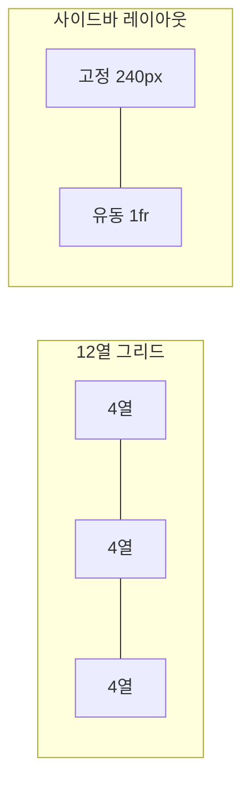

# 레이아웃과 간격

레이아웃은 **무엇이 중요하고 무엇이 관련 있는지**를 위치·크기·간격으로 전달합니다. 체계적인 간격과 그리드를 쓰면 화면마다 다른 판단을 하지 않아도 되고, 개발자와 디자이너가 같은 수치로 대화할 수 있습니다.

## 간격 체계

| 단계 | 값(8pt 기준) | 용도 |
| --- | --- | --- |
| 1 | 4px | 아이콘과 텍스트 사이, 인라인 요소 |
| 2 | 8px | 관련 요소 사이(라벨과 입력) |
| 3 | 12px | 작은 그룹 내부 |
| 4 | 16px | 컴포넌트 내부 패딩, 목록 항목 |
| 5 | 24px | 그룹 사이 |
| 6 | 32px | 섹션 내부 블록 사이 |
| 7 | 48px | 섹션 사이 |
| 8 | 64px 이상 | 페이지 영역 사이 |

| 원칙 | 설명 |
| --- | --- |
| 고정 단계만 사용 | 13px, 18px 같은 임의 값 금지. 토큰으로 정의 |
| 관계를 간격으로 | 가까운 것은 관련, 먼 것은 무관(근접성) |
| 안쪽 < 바깥쪽 | 컴포넌트 내부 간격은 컴포넌트 사이 간격보다 작게 |
| 수직 리듬 | 세로 간격을 기준 단위의 배수로 유지 |

## 그리드

| 종류 | 설명 | 적합 |
| --- | --- | --- |
| 열 그리드 | 12열(또는 4·8열 모바일), 거터·마진 정의 | 콘텐츠 페이지, 카드 배치 |
| 고정 + 유동 | 사이드바 고정, 본문 유동 | 앱, 관리 화면 |
| 모듈 그리드 | 행과 열 모두 | 대시보드 |
| 기준선 그리드 | 텍스트 행간에 맞춘 수평선 | 긴 글 |

| 설정 | 데스크톱 | 태블릿 | 모바일 |
| --- | --- | --- | --- |
| 열 수 | 12 | 8 | 4 |
| 거터 | 24px | 16px | 16px |
| 바깥 여백 | 32px 이상 | 24px | 16px |
| 최대 본문 폭 | 1200~1440px | - | - |

CSS Grid와 Flexbox로 구현하되, 디자인 도구의 그리드 설정과 수치를 맞춥니다.

## 시각 위계

사용자의 시선은 **크기 → 대비 → 색 → 위치** 순으로 끌립니다.

| 수단 | 강조 | 약화 |
| --- | --- | --- |
| 크기 | 큰 제목, 큰 숫자 | 작은 보조 텍스트 |
| 굵기 | 굵게 | 보통·가늘게 |
| 색·대비 | 진한 텍스트, 강조색 | 회색 텍스트 |
| 위치 | 좌상단, 첫 화면 | 아래, 접힘 |
| 여백 | 주변 여백 넓게 | 빽빽하게 |
| 요소 수 | 한 화면에 강조 1~2개 | 나머지 |

강조가 셋 이상이면 아무것도 강조되지 않습니다. 화면마다 "가장 먼저 봐야 할 것 하나"를 정합니다.

## 정렬

| 원칙 | 설명 |
| --- | --- |
| 왼쪽 정렬 기본 | 텍스트와 폼은 왼쪽 정렬이 읽기 쉬움 |
| 숫자는 오른쪽 | 표의 금액·수량은 오른쪽 정렬, 소수점 맞춤 |
| 가운데 정렬 제한 | 짧은 제목·빈 상태·대화상자만 |
| 기준선 공유 | 같은 행의 요소는 하나의 선에 정렬 |
| 라벨 정렬 | 폼 라벨은 위쪽 배치가 가장 빠름. 왼쪽 배치는 넓은 화면·긴 폼 |

## 콘텐츠 폭과 밀도

| 항목 | 권장 |
| --- | --- |
| 본문 한 줄 길이 | 영문 45~75자, 한글 30~45자 |
| 표·데이터 | 넓게, 가로 스크롤보다 열 선택·고정 열 |
| 밀도 | 소비자 앱은 여유, 전문가 도구는 조밀. 밀도 옵션 제공 가능 |
| 카드 | 같은 높이, 같은 내부 구조 |

## 흔한 문제

| 문제 | 대응 |
| --- | --- |
| 간격이 화면마다 다름 | 간격 토큰만 사용, 린트·리뷰 |
| 모든 것이 같은 크기 | 위계 1·2·3 수준으로 구분 |
| 관련 없는 요소가 붙어 있음 | 그룹 사이 간격을 2배 이상 |
| 긴 줄 | 최대 폭 제한(`max-width: 65ch`) |
| 화면이 비어 보이거나 빽빽함 | 밀도를 작업 유형에 맞춤, 여백은 의도적으로 |

관련: [타이포그래피](./typography.md), [반응형과 모션](../systems/responsive-and-motion.md), [디자인 시스템](../systems/design-system.md)

다음: [타이포그래피](./typography.md)
