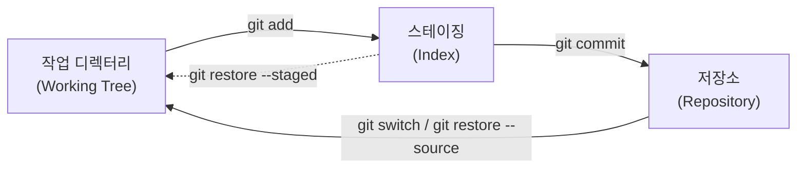

# Git 기본 모델

> 명령어를 외우기 전에 Git이 **데이터를 어떻게 저장하고, 영역 사이를 어떻게 옮기는지** 이해하기

[rebase](./rebase.md), [cherry-pick](./cherry-pick.md), [Tips](./tips.md)의 설명은 모두 이 모델 위에 있습니다. 이 문서의 모든 출력은 Git 2.52.0 임시 저장소에서 실행한 결과입니다.

---

## 개념 1: Git은 "스냅샷"을 내용 주소로 저장한다

Git은 파일의 **변경분이 아니라 그 시점의 전체 모습(스냅샷)** 을 저장하고, 모든 객체를 **내용의 해시**로 식별합니다. 객체는 네 종류입니다.

| 객체 | 담는 것 | 비유 |
| --- | --- | --- |
| **blob** | 파일 **내용** (이름 없음) | 파일 |
| **tree** | blob/tree의 **이름과 모드 목록** | 디렉터리 |
| **commit** | tree 하나 + **부모 커밋** + 작성자 + 메시지 | 스냅샷 + 이력 연결 |
| **tag** (주석 태그) | 커밋을 가리키는 이름 + 메시지 | 이름표 |

```bash
git cat-file -p HEAD                  # 커밋
tree 2e81171448eb9f2ee3821e3d447aa6b2fe3ddba1
author T <t@e> 1767193200 +0900
first

git cat-file -p 2e81171              # tree: 이름 → blob 연결
100644 blob ce013625030ba8dba906f756967f9e9ca394464a	a.txt

git cat-file -p ce01362              # blob: 내용
hello
```

**커밋 → tree → blob**의 사슬입니다. 해시가 **내용에서 계산되므로** 다음 성질이 따라옵니다.

- **같은 내용은 같은 해시**입니다. `a.txt`와 `b.txt`가 둘 다 `hello`이면 `git hash-object`가 같은 blob 해시(`ce01362...`)를 냅니다. 같은 내용은 한 번만 저장됩니다.
- **커밋 해시는 내용 + 부모에 의존**합니다. 그래서 부모가 바뀌면 해시가 바뀌고, 이것이 [rebase가 커밋을 "다시 만드는" 이유](./rebase.md#개념-rebase는-커밋을-옮기는-것이-아니라-다시-만드는-것)입니다.
- 객체는 **불변**입니다. "수정"은 새 객체를 만드는 일입니다.

### 브랜치와 HEAD는 그냥 "포인터"다

```bash
git branch feature
cat .git/refs/heads/feature          # 53f5d2eee03b...  ← 파일 한 줄: 커밋 해시
cat .git/HEAD                        # ref: refs/heads/main
```

- **브랜치**는 커밋 해시 하나를 담은 파일입니다. 브랜치를 만드는 것은 **포인터 하나를 만드는 것**이라 가볍고, 커밋하면 현재 브랜치의 포인터가 새 커밋으로 이동합니다.
- **`HEAD`** 는 "지금 어디에 있는가"로, 보통 **브랜치를 가리킵니다**(`ref: refs/heads/main`).
- **detached HEAD**는 `HEAD`가 브랜치가 아니라 **커밋을 직접** 가리키는 상태입니다(`git switch --detach <커밋>` 후 `HEAD detached at 46dac47`). 이 상태에서 만든 커밋은 어느 브랜치에도 속하지 않아, 다른 곳으로 이동하면 찾기 어려워집니다. 작업하려면 먼저 `git switch -c <새 브랜치>`로 이름을 붙입니다.
- **태그**는 두 종류입니다. 가볍게 이름만 붙이는 **lightweight 태그**(`git tag light`)는 커밋을 직접 가리키고(`git cat-file -t light` → `commit`), 메시지와 작성자를 담는 **주석(annotated) 태그**(`git tag -a v1.0 -m ...`)는 별도의 `tag` 객체입니다. 릴리스에는 주석 태그를 씁니다.

---

## 개념 2: 변경은 세 영역을 지나간다



| 영역 | 무엇인가 | 확인 명령 |
| --- | --- | --- |
| **작업 디렉터리** | 실제 파일 | `git status`, `git diff` |
| **스테이징(인덱스)** | **다음 커밋에 들어갈 내용** | `git diff --staged` |
| **저장소** | 커밋된 이력 | `git log` |

스테이징이 있는 이유는 **한 번의 작업에서 여러 변경을 논리 단위로 나눠 커밋**하기 위해서입니다(`git add -p`로 일부만 선택). 실제 출력입니다.

```bash
echo "v2" >> a.txt
git status --short        #  M a.txt      ← 작업 디렉터리만 바뀜 (두 번째 열)
git add a.txt
git status --short        # M  a.txt      ← 스테이징됨 (첫 번째 열)
git diff                  # (비어 있음)   ← 작업 디렉터리 vs 스테이징 차이 없음
git diff --staged         # +v2           ← 스테이징 vs 마지막 커밋 차이
```

`git status --short`의 두 글자는 **(스테이징 상태)(작업 디렉터리 상태)** 입니다.

---

## 되돌리기: 어느 영역을 되돌릴 것인가

"되돌리기"는 하나가 아니라 **어느 영역을 어디까지 되돌리느냐**입니다.

| 하고 싶은 일 | 명령 | 영향 |
| --- | --- | --- |
| 작업 디렉터리의 수정을 버리기 | `git restore <파일>` | **복구 불가** (커밋하지 않은 변경 삭제) |
| 스테이징만 취소 (수정은 유지) | `git restore --staged <파일>` | 파일은 그대로, `M `이 ` M`로 돌아감 |
| 마지막 커밋 취소, 변경은 스테이징에 유지 | `git reset --soft HEAD~1` | 커밋만 제거 |
| 마지막 커밋 취소, 변경은 작업 디렉터리에 유지 | `git reset HEAD~1` (`--mixed`) | 커밋과 스테이징 제거 |
| 커밋과 변경 모두 버리기 | `git reset --hard HEAD~1` | **작업 디렉터리 변경도 삭제** |
| **이미 공유한 커밋 취소** | `git revert <커밋>` | 취소하는 **새 커밋**을 추가. 이력은 지우지 않음 |

- 실행해 보면 `git revert --no-edit HEAD`는 `Revert "c2"` 커밋을 **추가**하고 `c2`는 이력에 남습니다.
- **공유한(push한) 커밋은 `reset`으로 지우지 말고 `revert`** 합니다. `reset`은 이력을 다시 쓰므로 [공유 브랜치 rebase와 같은 문제](./rebase.md#왜-공유한-브랜치를-rebase하면-안-되는가)가 생깁니다.
- `git checkout`은 브랜치 전환과 파일 복원을 둘 다 해서 헷갈렸기 때문에, 이제는 **`git switch`**(브랜치 이동)와 **`git restore`**(파일 복원)로 역할이 나뉘어 있습니다.
- 잘못 지웠다면 커밋된 것은 [reflog](./tips.md#2-git-reflog-head-이동-추적)로 복구할 수 있습니다. 커밋하지 않은 변경은 복구할 수 없습니다.

---

## 합치기: merge의 세 가지 모양

같은 두 브랜치를 합쳐도 **이력에 남는 모양**이 다릅니다. 실제로 실행한 결과입니다(`feat`에 커밋 2개).

```
fast-forward (main에 새 커밋이 없을 때)        --no-ff (병합 커밋 생성)
* 3fdc8aa feat 2                               *   f742f44 Merge feat
* 4a80e7c feat 1                               |\
* 8d773f2 A                                    | * 3fdc8aa feat 2
                                               | * 4a80e7c feat 1
squash (커밋 하나로 합침)                       |/
* a60019b feat (squashed)                      * 8d773f2 A
* 8d773f2 A
```

| 방식 | 명령 | 이력 | feat의 개별 커밋 |
| --- | --- | --- | --- |
| **fast-forward** | `git merge feat` | 직선 | 그대로 보존 |
| **병합 커밋** | `git merge --no-ff feat` | 갈라졌다 합쳐진 모양 | 보존 + 병합 지점 기록 |
| **squash** | `git merge --squash feat` 후 `git commit` | 직선, 커밋 하나 | **합쳐져 사라짐** (`feat` 브랜치에는 2개 그대로) |

- fast-forward는 `main`이 `feat`의 **조상일 때만** 가능합니다. `main`에도 새 커밋이 있으면(갈라진 상태) 병합 커밋이 필요하고, 직선 이력을 원하면 먼저 [rebase](./rebase.md)합니다.
- `squash`는 `feat`의 이력을 가져오지 않으므로, 이후 `feat`를 계속 쓰면 같은 변경이 다시 충돌할 수 있습니다. 합친 브랜치는 **버리는 것**이 원칙입니다([GitHub 문서도 squash는 단명 브랜치에 맞는다고 설명](./branching-and-commits.md#github-pr의-세-가지-merge-방식)).

---

## `.gitignore`는 이미 추적 중인 파일을 숨기지 못한다

`.gitignore`는 **아직 추적하지 않는 파일**이 `git status`에 나타나지 않게 할 뿐입니다. 이미 커밋한 파일은 `.gitignore`에 넣어도 **계속 추적**됩니다. `.env`를 실수로 커밋한 뒤 확인한 결과입니다.

```bash
echo ".env" > .gitignore
echo changed >> .env
git status --short       #  M .env        ← .gitignore에 넣어도 변경이 계속 보임
git rm --cached .env     # 추적만 해제 (파일은 남김)
git status --short       # D  .env
```

- 추적을 풀려면 `git rm --cached <파일>`을 쓰고 커밋합니다.
- **한 번 커밋된 비밀은 이력에 남습니다.** `git rm --cached`로는 과거 커밋에서 사라지지 않으므로 **키를 폐기·재발급**해야 합니다([환경변수 관리](../../Security/env-management.md#환경변수는-안전한-금고가-아니다)).

---

## 🎯 체크리스트

- [ ] `git status --short`의 두 열(스테이징 / 작업 디렉터리)을 읽을 수 있다
- [ ] 되돌리기 전에 **어느 영역**을 되돌리는지 확인 (`restore` / `reset` 모드 / `revert`)
- [ ] 공유한 커밋은 `reset`이 아니라 `revert`
- [ ] detached HEAD에서 작업했다면 브랜치를 만들어 이름을 붙임
- [ ] 릴리스는 주석 태그 (`git tag -a`)
- [ ] 비밀 파일은 처음부터 `.gitignore`, 이미 커밋했다면 키 폐기

## 참고 자료

- [Pro Git: Git Internals - Git Objects](https://git-scm.com/book/en/v2/Git-Internals-Git-Objects), [Git Branching - Branches in a Nutshell](https://git-scm.com/book/en/v2/Git-Branching-Branches-in-a-Nutshell)
- [git-restore](https://git-scm.com/docs/git-restore), [git-switch](https://git-scm.com/docs/git-switch), [git-reset](https://git-scm.com/docs/git-reset), [git-revert](https://git-scm.com/docs/git-revert)
- [git-merge](https://git-scm.com/docs/git-merge), [gitignore](https://git-scm.com/docs/gitignore)

확인일: 2026-10-23 (객체 모델의 `cat-file` 출력, 같은 내용의 같은 blob 해시, 브랜치·HEAD 파일 내용, 세 영역 사이의 `status`/`diff` 출력, lightweight·주석 태그의 객체 종류, fast-forward·`--no-ff`·`--squash` 결과, `restore`·`reset --soft`·`revert`·detached HEAD, `.gitignore`와 추적 중인 파일은 모두 Git 2.52.0 임시 저장소에서 직접 실행해 확인. 위에 링크한 Pro Git과 git 명령 문서는 이번에 열어서 대조하지 않았고 참고용 링크, 미확인. SHA-1과 SHA-256 저장소 형식 차이는 다루지 않음)
